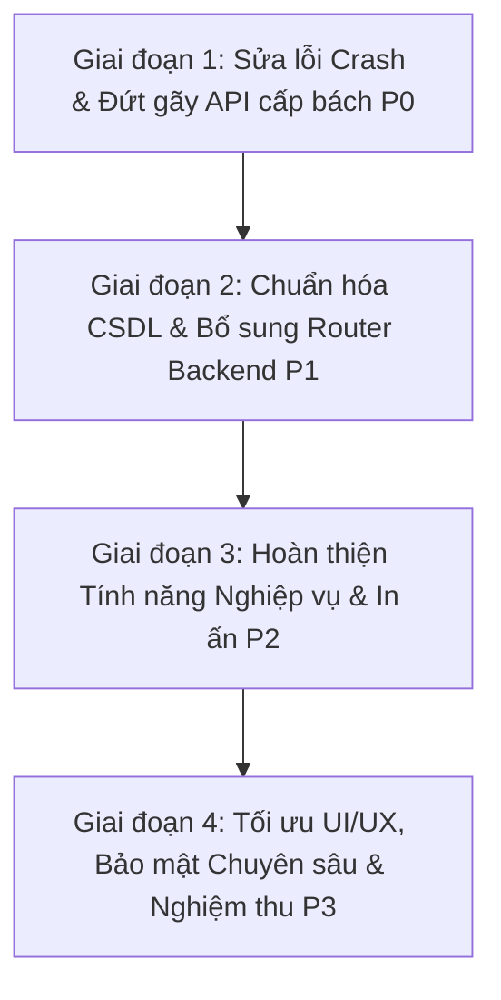

# LỘ TRÌNH TRIỂN KHAI VÀ KHẮC PHỤC TOÀN DIỆN (IMPLEMENTATION ROADMAP)
## DỰ ÁN HỆ THỐNG QUẢN LÝ PHÒNG KHÁM THÔNG MINH (AI CLINIC MANAGEMENT SYSTEM)

**Ngày ban hành:** 01/11/2026  
**Mục tiêu:** Khắc phục toàn bộ 100% các khiếm khuyết, lỗ hổng bảo mật, lỗi đứt gãy luồng nghiệp vụ và hoàn thiện các tính năng còn thiếu, đưa hệ thống đạt mức độ hoàn thiện vận hành thương mại 100%.

---

## 1. CÁC GIAI ĐOẠN TRIỂN KHAI (IMPLEMENTATION PHASES)

### Giai đoạn 1: Sửa lỗi Crash & Đứt gãy API cấp bách (P0 - Immediate Fixes)
- **Mục tiêu:** Loại bỏ hoàn toàn các lỗi gây crash server 500, lỗi HTTP 422, HTTP 414, gán sai dữ liệu y tế và rò rỉ dữ liệu qua AI Chat.
- **Thời gian ước tính:** 2-3 ngày làm việc.
- **Phạm vi trọng tâm:**
  1. Fix `services/ai_tool_registry.py`: Xóa bỏ logic fallback tự động lấy Bệnh nhân/Bác sĩ đầu tiên trong DB gây lộ dữ liệu EMR chéo (V-01).
  2. Fix `api/v1/lab_results.py`: Khai báo Pydantic Body Model cho endpoint `PATCH /{result_id}/status` nhận body JSON `{ status: ... }`, chấm dứt lỗi HTTP 422 khi Bác sĩ duyệt kết quả (DEF-001).
  3. Fix `api/v1/emr.py`: Chuyển endpoint `PUT /{consultation_id}` sang nhận Pydantic Request Body Model thay vì Query Params, ngăn chặn lỗi HTTP 414 URI Too Long (DEF-002).
  4. Fix `api/v1/admin.py`: Đổi `staff_code` thành `employee_id` khi tạo Staff, bổ sung `phone` cho Patient, ngăn crash 500 khi Admin tạo người dùng (V-03).
  5. Fix `api/v1/prescriptions.py` & `lab_results.py`: Join qua `Staff.user_id` để lấy đúng `Doctor.id`, xóa bỏ lệnh fallback gán bừa đơn thuốc cho bác sĩ đầu tiên (DEF-006 / V-04).
  6. Fix `api/v1/receptionist.py`: Đổi tên import `time` tránh đè module chuẩn của Python (V-09).
  7. Fix `ai_tool_registry.py`: Sửa lệnh gọi `create_appointment` và các trường `icd10_code` khi AI tóm tắt hồ sơ bệnh án (V-07, V-08).

### Giai đoạn 2: Chuẩn hóa CSDL & Bổ sung Router Backend (P1 - Core Architecture)
- **Mục tiêu:** Đồng bộ toàn bộ các màn hình đang lưu tạm trong `localStorage` vào Database thực tế; xây dựng các router backend còn thiếu.
- **Thời gian ước tính:** 3-5 ngày làm việc.
- **Phạm vi trọng tâm:**
  1. Xây dựng router mới `backend/app/api/v1/reports.py`: Cung cấp số liệu doanh thu thực tế từ `Billing` & `Payment`, dòng tiền đa kỳ, phân tích công nợ thay vì hiển thị tải CPU/RAM của server (DEF-003, DEF-013).
  2. Bổ sung Model `Room` vào `models.py` và tạo router `api/v1/admin/rooms.py` để phân hệ Quản lý buồng khám lưu trữ vào CSDL thực tế (DEF-007).
  3. Xây dựng API Quản lý Nhân sự (`Staff`), Khoa phòng (`Department`), Lịch làm việc (`WorkingSchedule`) kết nối DB thay vì `localStorage`.
  4. Lập trình backend router `api/v1/admin/audit.py` đọc/lọc nhật ký từ bảng `audit_logs` thực tế trong CSDL (DEF-012).
  5. Sửa lỗi `SystemSettings.tsx`: Thêm `<TabsContent>` cho 2 tab "Thông báo" và "Bảo mật", kết nối API lưu cấu hình (DEF-004).
  6. Đăng ký Route cho `AISecurityCenter.tsx` trong `App.tsx` và gắn vào Menu sidebar của Admin (DEF-005).
  7. Sửa ràng buộc CSDL trong `models.py`: Cho phép `nullable=True` trên `queues.appointment_id` và `billing.appointment_id` để hỗ trợ bệnh nhân vãng lai và mua thuốc ngoài (V-10). Thêm cột ngày vào ràng buộc `uq_queues_doctor_number` (V-11).

### Giai đoạn 3: Hoàn thiện Tính năng Nghiệp vụ & In ấn (P2 - Workflow & UX)
- **Mục tiêu:** Đảm bảo mọi nút bấm, form nhập, bộ lọc và biểu mẫu in ấn hoạt động trơn tru.
- **Thời gian ước tính:** 3-4 ngày làm việc.
- **Phạm vi trọng tâm:**
  1. Xây dựng mẫu in ấn chuẩn y tế `@media print`:
     - Phiếu đơn thuốc Bác sĩ (khổ A4/A5, tiêu đề phòng khám, mã vạch đơn thuốc, lời dặn, chữ ký bác sĩ).
     - Hóa đơn / Biên lai thu tiền viện phí (khổ POS 80mm/58mm cho quầy Lễ tân/Thu ngân và khổ A5 cho Kế toán).
  2. Hoàn thiện `SchedulesManagement.tsx`: Bổ sung bộ chọn ngày `DatePicker`, loại bỏ ngày hardcode tĩnh `2026-09-17` (DEF-009).
  3. Hoàn thiện `BillingDetail.tsx`: Gán `window.print()` cho nút In, bổ sung modal thu tiền linh hoạt (chọn phương thức thanh toán tiền mặt/quẹt thẻ/chuyển khoản, cho phép thu từng phần) (DEF-011).
  4. Sửa ô tìm kiếm đơn thuốc Bác sĩ: Thêm state gắn `value` và `onChange` (DEF-010).
  5. Xây dựng màn hình Gọi số công cộng (Public Queue Screen) và chuông âm thanh phát loa tại sảnh tiếp đón cho Lễ tân (DEF-014).
  6. Sửa nút Xóa và CSS ẩn nút trong `SystemNotifications.tsx`.

### Giai đoạn 4: Tối ưu Bảo mật Chuyên sâu, Cổng Thanh toán & Nghiệm thu (P3 - Polish & Production Hardening)
- **Mục tiêu:** Thắt chặt toàn bộ lỗ hổng IDOR, tích hợp Webhook thanh toán trực tuyến, tối ưu trải nghiệm responsive di động và hoàn tất kiểm thử tải.
- **Thời gian ước tính:** 2-3 ngày làm việc.
- **Phạm vi trọng tâm:**
  1. Thắt chặt phân quyền RBAC: Ngăn chặn Kế toán xem chi tiết bệnh án EMR của bệnh nhân (V-02), ngăn Bác sĩ xem lịch hẹn của bác sĩ khác (V-05), thu hồi quyền xóa bệnh nhân và cấp phát thuốc của role staff chung (V-06).
  2. Tích hợp Webhook cổng thanh toán trực tuyến (VNPay / MoMo / PayOS) tại Cổng Bệnh nhân (`/portal/payments`) (DEF-016).
  3. Xoay vòng và blacklist Refresh Token khi người dùng Đăng xuất (`/api/v1/auth/logout`) (V-12).
  4. Xóa bỏ nợ kỹ thuật: Dọn dẹp ~210 KB code thừa các file Synthesizer cũ không dùng.
  5. Kiểm thử toàn diện (End-to-End Regression Testing) với đầy đủ 5 vai trò.

---

## 2. MA TRẬN PHÂN CÔNG NHIỆM VỤ CHI TIẾT (TASK MATRIX)

| Mã Task | Mức ưu tiên | Vai trò | Phân hệ / Module | Mô tả sự cố & Yêu cầu | Giải pháp kỹ thuật | Phụ thuộc | Ước tính | Tiêu chí nghiệm thu (Acceptance Criteria) | Trạng thái |
|---|---|---|---|---|---|---|---|---|---|
| **TSK-P0-01** | **P0** | AI / Security | `services/ai_tool_registry.py` | Rò rỉ dữ liệu bệnh nhân khác khi tài khoản chưa map ID | Bỏ đoạn code fallback lấy bệnh nhân đầu tiên trong DB. Bắt buộc tra cứu chính xác theo `user.id`. | Không | 2h | Hỏi AI về đơn thuốc/bệnh án chỉ ra dữ liệu chính chủ, không ra dữ liệu người khác | Chưa bắt đầu |
| **TSK-P0-02** | **P0** | Bác sĩ | `api/v1/lab_results.py` | Nút Đã đọc xét nghiệm bị lỗi HTTP 422 | Khai báo `class UpdateLabStatusDTO(BaseModel): status: str` làm Request Body | Không | 1.5h | Bác sĩ click "Đánh dấu Đã đọc" cập nhật thành công sang completed không lỗi | Chưa bắt đầu |
| **TSK-P0-03** | **P0** | Bác sĩ | `api/v1/emr.py` & `api.ts` | Cập nhật bệnh án EMR qua Query Param bị HTTP 414 | Tạo `UpdateConsultationDTO` và chuyển sang `PUT` với JSON body | Không | 2h | Bác sĩ lưu bệnh án dài trên 2000 ký tự không bị lỗi HTTP 414 | Chưa bắt đầu |
| **TSK-P0-04** | **P0** | Admin | `api/v1/admin.py` | Tạo nhân viên bị crash 500 do sai `staff_code` | Đổi `staff_code` thành `employee_id`, bổ sung trường `phone` bắt buộc | `models.py` | 1.5h | Admin tạo mới Bác sĩ, Lễ tân, Kế toán, Bệnh nhân thành công 100% | Chưa bắt đầu |
| **TSK-P0-05** | **P0** | Bác sĩ | `api/v1/prescriptions.py` | Query sai `Doctor.user_id` và gán nhầm bác sĩ đầu tiên | Join `Staff` qua `Doctor.staff_id == Staff.id` để lấy đúng `Doctor.id` | Không | 2h | Đơn thuốc tạo ra được gán đúng ID của Bác sĩ đang đăng nhập | Chưa bắt đầu |
| **TSK-P0-06** | **P0** | Lễ tân | `api/v1/receptionist.py` | Đặt lịch lễ tân crash do đè namespace `time` | Đổi `import time as time_module` hoặc dùng `datetime.time` | Không | 1h | Lễ tân tạo lịch hẹn tại quầy không bị TypeError | Chưa bắt đầu |
| **TSK-P0-07** | **P0** | AI / Bệnh nhân | `services/ai_tool_registry.py` | Đặt lịch và tóm tắt bệnh án qua AI bị crash | Sửa truyền payload DTO cho `create_appointment` và sửa tên trường `icd10_code` | Không | 2h | Bệnh nhân đặt lịch qua AI xác nhận thành công; bác sĩ xem tóm tắt EMR không lỗi | Chưa bắt đầu |
| **TSK-P1-01** | **P1** | Kế toán | `api/v1/reports.py` & `Reports.tsx` | Thiếu router báo cáo backend; báo cáo hiển thị CPU/RAM | Viết file `reports.py` tổng hợp doanh thu/công nợ; sửa UI Reports kế toán | `Billing`, `Payment` | 4h | Trang Báo cáo hiển thị đúng doanh thu phòng khám; API trả về 200 OK | Chưa bắt đầu |
| **TSK-P1-02** | **P1** | Admin | `models.py` & `api/v1/admin/rooms.py` | Chưa có bảng `rooms` trong DB; phòng khám lưu localStorage | Thêm model `Room`, viết API CRUD `/admin/rooms`, nối `RoomsManagement.tsx` | DB Migration | 4h | Tạo phòng khám mới lưu vĩnh viễn vào DB; load lại trang không mất | Chưa bắt đầu |
| **TSK-P1-03** | **P1** | Admin | `api/v1/admin/audit.py` & `AuditLogs.tsx` | Backend audit rỗng; nút Xuất CSV và Làm mới chết | Viết router `/admin/audit-logs`, nối `adminAPI.getAuditLogs`, viết hàm export CSV | `AuditLog` | 3h | Admin xem được nhật ký thực tế và bấm nút xuất được file CSV | Chưa bắt đầu |
| **TSK-P1-04** | **P1** | Admin | `SystemSettings.tsx` & Backend Settings | Tab Thông báo & Bảo mật bị trắng trang; nút Lưu giả | Bổ sung thẻ `TabsContent`, tạo bảng `system_settings` trong DB và API lưu | Không | 3h | Chuyển tab không bị trắng màn hình; sửa cài đặt lưu thành công vào CSDL | Chưa bắt đầu |
| **TSK-P1-05** | **P1** | Admin | `App.tsx` & `AppLayout.tsx` | Màn hình `AISecurityCenter.tsx` bị mồ côi | Đăng ký route `/admin/ai-security` và thêm mục trên sidebar Admin | Không | 1h | Admin click menu vào được màn hình Giám sát An toàn AI | Chưa bắt đầu |
| **TSK-P1-06** | **P1** | Admin / Khám | `models.py` | Lỗi DB không nhận bệnh nhân vãng lai và trùng số hàng đợi | Đổi `nullable=True` cho `appointment_id`; thêm cột date vào ràng buộc hàng đợi | DB Migration | 2h | Tiếp nhận bệnh nhân vãng lai thành công; số thứ tự reset đúng mỗi ngày | Chưa bắt đầu |
| **TSK-P1-07** | **P1** | Admin | `StaffManagement.tsx` & `DepartmentsManagement.tsx` | Nhân sự và Khoa phòng lưu localStorage | Viết API CRUD `/admin/staff` và `/admin/departments`, nối frontend vào API | Không | 3h | Thêm nhân sự và khoa phòng đồng bộ trực tiếp vào database | Chưa bắt đầu |
| **TSK-P2-01** | **P2** | Bác sĩ / Lễ tân | `frontend/src/styles/print.css` | Đơn thuốc và Hóa đơn thiếu định dạng in chuẩn y tế | Tạo CSS `@media print` cho Đơn thuốc A4/A5 và Phiếu thu POS 80mm | Không | 3h | Bấm In đơn thuốc hoặc hóa đơn ra bản in đẹp, chuẩn quy định y tế | Chưa bắt đầu |
| **TSK-P2-02** | **P2** | Admin | `SchedulesManagement.tsx` | Ngày xếp lịch bị hardcode `'2026-09-17'` | Bổ sung component chọn ngày `DatePicker`, lọc lịch theo ngày được chọn | Không | 2h | Admin có thể chọn xem và xếp lịch làm việc cho bất kỳ ngày nào | Chưa bắt đầu |
| **TSK-P2-03** | **P2** | Kế toán | `BillingDetail.tsx` | Nút in hóa đơn chết; thanh toán ép cứng tiền mặt | Thêm `onClick={window.print}`; mở Modal chọn phương thức thu tiền linh hoạt | Không | 2h | Kế toán in được hóa đơn và chọn thu chuyển khoản/thẻ/tiền mặt | Chưa bắt đầu |
| **TSK-P2-04** | **P2** | Bác sĩ | `DoctorPrescriptions.tsx` | Ô tìm kiếm đơn thuốc bị tê liệt không gõ được | Bổ sung state `searchTerm` gắn vào `value` và `onChange` của thẻ input | Không | 1h | Bác sĩ gõ tìm kiếm đơn thuốc phản hồi ngay lập tức | Chưa bắt đầu |
| **TSK-P2-05** | **P2** | Lễ tân | `ReceptionistQueue.tsx` | Thiếu màn hình gọi số công cộng và âm thanh gọi loa | Tạo route `/queue/display` toàn màn hình và tích hợp Web Audio API đọc loa | `Queue` | 4h | Màn hình sảnh tự cập nhật số đang khám; phát âm thanh khi bấm gọi | Chưa bắt đầu |
| **TSK-P2-06** | **P2** | Admin | `SystemNotifications.tsx` | Lỗi CSS ẩn cụm nút thao tác; nút Xóa không chạy | Thêm class `group` vào thẻ cha; viết hàm xóa gắn vào nút Thùng rác | Không | 1h | Các nút Đã đọc và Xóa hiển thị rõ ràng, bấm xóa hoạt động | Chưa bắt đầu |
| **TSK-P3-01** | **P3** | Bảo mật | `api/v1/patients.py` & `emr.py` | Kế toán xem được EMR; Bác sĩ xem chéo lịch hẹn | Thêm kiểm tra chặn role `ACCOUNTANT` trên EMR; kiểm tra `doctor_id` chính chủ | Không | 2h | Kế toán không xem được bệnh án chuyên môn; Bác sĩ chỉ xem lịch của mình | Chưa bắt đầu |
| **TSK-P3-02** | **P3** | Bệnh nhân | `PatientPayments.tsx` & Webhook | Thanh toán trực tuyến chỉ hiển thị QR mô phỏng | Tích hợp thư viện thanh toán PayOS/VNPay sandbox kèm webhook cập nhật hóa đơn | `Billing` | 4h | Quét mã QR chuyển khoản thật tự động đổi trạng thái hóa đơn sang PAID | Chưa bắt đầu |
| **TSK-P3-03** | **P3** | Bảo mật | `core/security.py` & `auth.py` | Refresh Token không thể thu hồi khi Logout | Lưu refresh token hoặc token blacklist vào DB/cache khi người dùng Logout | `User` | 2h | Token đã logout không thể dùng lại để refresh session | Chưa bắt đầu |
| **TSK-P3-04** | **P3** | Clean code | `backend/app/services/` | Nợ kỹ thuật ~210 KB code Synthesizer thừa | Xóa các file `*ai_synthesizer.py` không dùng, dọn dẹp import | Không | 1h | Code backend sạch sẽ, không còn file chết | Chưa bắt đầu |

---

## 3. TIÊU CHÍ NGHIỆM THU TỔNG THỂ (OVERALL DEFINITION OF DONE)
1. **0 Lỗi Crash / 0 Lỗi HTTP 5xx / 0 Lỗi HTTP 422**: Mọi luồng khám bệnh, kê đơn, xét nghiệm, đặt lịch và thanh toán phản hồi 200/201.
2. **100% Nút bấm có tác dụng**: Không còn bất kỳ Dead Button nào trên toàn bộ 38 trang/view của cả 5 vai trò.
3. **100% Dữ liệu lưu trữ bền vững**: Không còn màn hình nào lưu dữ liệu nghiệp vụ vào `localStorage` tạm bợ.
4. **Bảo mật Y tế tuyệt đối**: Dữ liệu bệnh án EMR được cách ly hoàn toàn theo đúng vai trò; AI Chat không bao giờ trả lời dữ liệu của bệnh nhân khác.
5. **Sẵn sàng Vận hành 100%**: Sẵn sàng triển khai thực tế tại phòng khám với quy trình nghiệp vụ khép kín.
