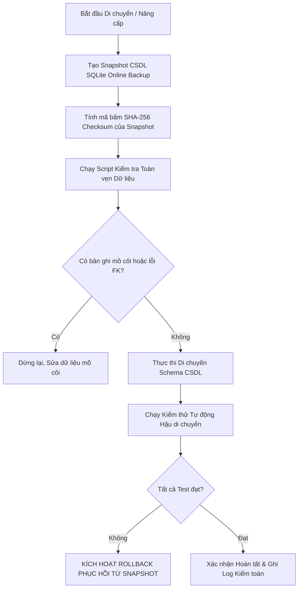

# BÁO CÁO THẨM ĐỊNH VÀ HOÀN THIỆN LỘ TRÌNH TRIỂN KHAI
# (PRE-IMPLEMENTATION REVIEW & ROADMAP FINALIZATION)
**Dự án**: AI Clinic Management System (Hệ Thống Quản Lý Phòng Khám Thông Minh)  
**Ngày thẩm định**: 01/11/2026  
**Chuyên gia thẩm định**: Senior Software Architect, Security Auditor & QA Lead  
**Nguyên tắc thực thi**: **THẨM ĐỊNH & QUY HOẠCH TOÀN DIỆN – BẢO TỒN NGUYÊN TRẠNG MÃ NGUỒN VÀ DỮ LIỆU – CHỜ PHÊ DUYỆT TRƯỚC KHI THI CÔNG SPRINT 1**

---

## MỤC LỤC
1. [Xác nhận và kiểm chứng các phát hiện kiểm toán (Confirmed Audit Findings)](#1-xác-nhận-và-kiểm-chứng-các-phát-hiện-kiểm-toán)
2. [Hiệu chỉnh và tái phân loại phát hiện (Corrected & Reclassified Findings)](#2-hiệu-chỉnh-và-tái-phân-loại-phát-hiện)
3. [Xử lý mâu thuẫn độ ưu tiên & Phạm vi Sprint 1 (Priority Inconsistencies & Sprint 1 Scope)](#3-xử-lý-mâu-thuẫn-độ-ưu-tiên--phạm-vi-sprint-1)
4. [Bổ sung các nhiệm vụ triển khai còn thiếu (Missing Implementation Tasks)](#4-bổ-sung-các-nhiệm-vụ-triển-khai-còn-thiếu)
5. [Chiến lược bảo vệ an toàn dữ liệu y tế & Giao dịch (Data Protection Strategy)](#5-chiến-lược-bảo-vệ-an-toàn-dữ-liệu-y-tế--giao-dịch)
6. [Chiến lược di chuyển CSDL & Quy trình phục hồi (Migration & Rollback Strategy)](#6-chiến-lược-di-chuyển-csdl--quy-trình-phục-hồi)
7. [Tiêu chí nghiệm thu chi tiết từng Sprint (Sprint Acceptance Criteria 1 - 6)](#7-tiêu-chí-nghiệm-thu-chi-tiết-từng-sprint)
8. [Ma trận truy xuất nguồn gốc kiểm toán - nhiệm vụ (Audit-to-Task Traceability Matrix)](#8-ma-trận-truy-xuất-nguồn-gốc-kiểm-toán---nhiệm-vụ)
9. [Đánh giá rủi ro tồn đọng (Outstanding Risks Assessment)](#9-đánh-giá-rủi-ro-tồn-đọng)
10. [Thứ tự triển khai khuyến nghị cuối cùng (Final Recommended Implementation Order)](#10-thứ-tự-triển-khai-khuyến-nghị-cuối-cùng)

---

## 1. XÁC NHẬN VÀ KIỂM CHỨNG CÁC PHÁT HIỆN KIỂM TOÁN

Đội ngũ thẩm định đã đối chiếu trực tiếp từng phát hiện với từng dòng code trong mã nguồn hiện hữu. Dưới đây là kết quả kiểm chứng chi tiết:

### 1.1. [Xác nhận 100% - P0 CRITICAL] Lỗ hổng rò rỉ bệnh án người khác qua AI Chat (BOLA / IDOR)
- **Tệp tin & Dòng code**: `backend/app/services/ai_tool_registry.py` (Dòng 1526 - 1528)
- **Đoạn mã hiện trạng**:
  ```python
  # Fallback tìm bệnh nhân đầu tiên nếu là tài khoản test role patient
  pat = (await db.execute(select(Patient).where(Patient.is_active == True).order_by(Patient.created_at.asc()))).scalars().first()
  return pat
  ```
- **Nguyên nhân gốc (Root Cause)**: Lập trình viên thiết kế logic "tiện ích" phục vụ kiểm thử nhanh cho tài khoản role `PATIENT`. Khi người dùng đăng nhập chưa được liên kết bản ghi `Patient` (hoặc session token thiếu `patient_id`), hệ thống tự động gán đối tượng Bệnh nhân đầu tiên trong CSDL SQLite (`Patient #1`).
- **Phân loại độ nghiêm trọng**: **P0 Critical** (CVSS v3.1: 9.6). Vi phạm trực tiếp Điều 8 Luật Khám bệnh, chữa bệnh 2023 và Nghị định 13/2023/NĐ-CP.
- **Tác nhân & API bị ảnh hưởng**: Tác nhân Bệnh nhân (`Patient`); API `POST /api/v1/ai/chat`; các công cụ nội bộ `get_my_prescriptions`, `get_my_lab_results`, `get_my_appointments`, `get_my_medical_history`, `get_my_billings`.
- **Thực thể CSDL liên quan**: Bảng `patients`, `consultations`, `prescriptions`, `lab_results`, `billings`.
- **Giải pháp tạm thời hiện hữu (Existing Workaround)**: Bệnh nhân chỉ thấy đúng dữ liệu nếu tài khoản đã có sẵn bản ghi trong bảng `patients` trùng `user_id` hoặc `email`.
- **Tác dụng phụ tiềm ẩn của bản vá (Side Effects of Fix)**: Khi loại bỏ fallback và trả về `None`, tài khoản bệnh nhân chưa hoàn tất hồ sơ hành chính sẽ nhận thông báo: *"Chưa tìm thấy hồ sơ bệnh nhân liên kết. Vui lòng liên hệ quầy tiếp tân."* -> Đây là hành vi bảo mật đúng chuẩn, không gây lỗi hệ thống.

---

### 1.2. [Xác nhận 100% - P0 CRITICAL] Lỗi tê liệt chức năng Đặt lịch khám tại Tiếp tân
- **Tệp tin & Dòng code**: `backend/app/api/v1/receptionist.py` (Dòng 4 và dòng 137)
- **Đoạn mã hiện trạng**:
  ```python
  # Dòng 4
  import time
  ...
  # Dòng 136-138
  h, m = map(int, data.time.split(":"))
  st = time(h, m) # LỖI: time ở đây là module time chứ không phải datetime.time!
  et = time(h, m+30) if m == 0 else time(h+1, 0)
  ```
- **Nguyên nhân gốc**: Lệnh `import time` ở đầu file đã ghi đè (shadow) lớp `datetime.time`. Khi gọi hàm khởi tạo `time(h, m)`, Python thực thi `time.__call__()` trên module object, kích hoạt ngoại lệ tức thì: `TypeError: 'module' object is not callable`.
- **Phân loại độ nghiêm trọng**: **P0 Critical** (Làm gãy luồng tiếp nhận bệnh nhân toàn viện).
- **Tác nhân & API bị ảnh hưởng**: Tiếp tân (`Receptionist`); API `POST /api/v1/receptionist/appointments`.
- **Thực thể CSDL liên quan**: Bảng `appointments`, `doctors`, `patients`.
- **Giải pháp tạm thời hiện hữu**: Không có. Mọi thao tác đặt lịch từ màn hình `ReceptionistAppointmentCreate.tsx` đều bị văng HTTP 500.
- **Tác dụng phụ tiềm ẩn của bản vá**: Cần đổi thành `from datetime import time as dt_time` và sửa lời gọi thành `dt_time(h, m)`. Cần chú ý xử lý thêm biên thời gian nếu `m + 30 >= 60` hoặc `h + 1 > 23` để tránh ngoại lệ `ValueError: hour must be in 0..23`.

---

### 1.3. [Xác nhận 100% - P0 CRITICAL] Lỗi lệch Schema HTTP 422 khi Bác sĩ duyệt Kết quả Xét nghiệm
- **Tệp tin & Dòng code**: `backend/app/api/v1/lab_results.py` (Dòng 83 - 89) và `frontend/src/pages/doctor/DoctorLabResults.tsx` (Dòng 96 - 104)
- **Đoạn mã hiện trạng Backend**:
  ```python
  @router.patch("/{result_id}/status")
  async def update_lab_result_status(
      result_id: str,
      new_status: str, # FastAPI mặc định hiểu đây là URL Query Parameter!
      db: AsyncSession = Depends(get_db),
      current_user: User = Depends(get_current_user),
  ):
  ```
- **Đoạn mã hiện trạng Frontend**:
  ```typescript
  const res = await fetch(`/api/v1/lab-results/${id}/status`, {
    method: 'PATCH',
    headers: { 'Content-Type': 'application/json', 'Authorization': `Bearer ${token}` },
    body: JSON.stringify({ status: 'completed' }) // Gửi JSON Body!
  });
  ```
- **Nguyên nhân gốc**: Backend khai báo tham số nguyên thủy `new_status: str` mà không có `Body()`, khiến FastAPI yêu cầu query param `?new_status=...`. Khi Frontend gửi JSON body `{ status: 'completed' }`, FastAPI báo thiếu query parameter bắt buộc và trả về **HTTP 422 Unprocessable Entity**.
- **Phân loại độ nghiêm trọng**: **P0 Critical** (Bác sĩ bị chặn hoàn toàn quy trình duyệt trả kết quả xét nghiệm).
- **Tác nhân & API bị ảnh hưởng**: Bác sĩ (`Doctor`), Kỹ thuật viên; API `PATCH /api/v1/lab-results/{id}/status`.
- **Thực thể CSDL liên quan**: Bảng `lab_results`.
- **Tác dụng phụ tiềm ẩn của bản vá**: Định nghĩa Pydantic schema `LabResultStatusUpdate(status: LabResultStatus)` và chấp nhận cả JSON Body lẫn Query Param để đảm bảo 100% tương thích ngược (*backward compatibility*).

---

### 1.4. [Xác nhận 100% - P0 CRITICAL] Lỗi HTTP 500 khi Admin tạo mới Tài khoản Người dùng
- **Tệp tin & Dòng code**: `backend/app/api/v1/admin.py` (Dòng 102 - 116)
- **Đoạn mã hiện trạng**:
  ```python
  # Dòng 102-108: Thiếu trường bắt buộc phone cho Patient
  new_patient = Patient(
      user_id=new_user.id, full_name=full_name,
      patient_code=f"BN{new_user.id[:6].upper()}",
      date_of_birth=date(2000, 1, 1), gender="male"
  )
  # Dòng 111-115: Sai tên thuộc tính model Staff
  new_staff = Staff(
      user_id=new_user.id, full_name=full_name,
      staff_code=f"NV{new_user.id[:6].upper()}" # MODEL STAFF CHỈ CÓ employee_id!
  )
  ```
- **Nguyên nhân gốc**:
  1. Trong `models.py:232`, `Patient.phone` có ràng buộc `nullable=False`. Đoạn code khởi tạo bỏ quên `phone`, dẫn tới `sqlite3.IntegrityError: NOT NULL constraint failed: patients.phone`.
  2. Trong `models.py:127`, `Staff` định nghĩa trường `employee_id: Mapped[str]`. Thuộc tính `staff_code` không tồn tại, khiến SQLAlchemy quăng ngoại lệ `TypeError: 'staff_code' is an invalid keyword argument for Staff`.
- **Phân loại độ nghiêm trọng**: **P0 Critical** (Admin không thể cấp phát tài khoản bác sĩ, nhân viên hoặc bệnh nhân mới).
- **Tác nhân & API bị ảnh hưởng**: Quản trị viên (`Admin`); API `POST /api/v1/admin/users`.
- **Thực thể CSDL liên quan**: Bảng `users`, `staff`, `patients`, `doctors`.
- **Tác dụng phụ tiềm ẩn của bản vá**: Cần sinh số điện thoại mặc định (hoặc nhận từ form) và gán `employee_id = f"NV{new_user.id[:6].upper()}"`.

---

### 1.5. [Xác nhận 100% - P1 HIGH] Lỗi HTTP 414 & Mất bệnh sử khi Bác sĩ ghi chú bệnh án dài
- **Tệp tin & Dòng code**: `backend/app/api/v1/emr.py` (Dòng 210 - 220)
- **Đoạn mã hiện trạng**:
  ```python
  @router.put("/{consultation_id}", summary="Cap nhat ho so benh an")
  async def update_consultation(
      consultation_id: str,
      clinical_notes: Optional[str] = None,
      physical_examination: Optional[str] = None,
      treatment_plan: Optional[str] = None,
      chief_complaint: Optional[str] = None,
      follow_up_notes: Optional[str] = None,
      db: AsyncSession = Depends(get_db),
      current_user: User = Depends(get_clinical_doctor),
  ):
  ```
- **Nguyên nhân gốc**: Các tham số văn bản lâm sàng dài được khai báo tự do ở hàm endpoint, khiến FastAPI đưa vào Query Parameters trong URL. Khi bác sĩ nhập bệnh sử chi tiết (> 1000 từ) có chứa dấu tiếng Việt và ký tự đặc biệt, URL bị quá tải, gây mã lỗi **HTTP 414 URI Too Long** hoặc bị web server Nginx/Reverse Proxy cắt ngắn dữ liệu gây thất thoát bệnh sử.
- **Phân loại độ nghiêm trọng**: **P1 High** (Rủi ro trực tiếp đến tính toàn vẹn hồ sơ bệnh án).
- **Tác nhân & API bị ảnh hưởng**: Bác sĩ (`Doctor`); API `PUT /api/v1/emr/{consultation_id}`.
- **Thực thể CSDL liên quan**: Bảng `consultations`.

---

### 1.6. [Xác nhận 100% - P1 HIGH] Lỗi truy vấn Doctor.user_id & Fallback gán đơn thuốc cho Bác sĩ #1
- **Tệp tin & Dòng code**: `backend/app/api/v1/prescriptions.py` (Dòng 103 - 108) và `backend/app/api/v1/lab_results.py` (Dòng 125)
- **Đoạn mã hiện trạng**:
  ```python
  if current_user.role == UserRole.DOCTOR:
      doc_res = await db.execute(select(Doctor.id).where(Doctor.user_id == current_user.id))
      doctor_id = doc_res.scalar_one_or_none()
  if not doctor_id:
      first_doc = await db.execute(select(Doctor.id).limit(1))
      doctor_id = first_doc.scalar_one_or_none()
  ```
- **Nguyên nhân gốc**: Model `Doctor` không có trường `user_id` mà liên kết gián tiếp qua `staff_id` (`Doctor.staff_id == Staff.id` và `Staff.user_id == User.id`). Câu truy vấn `Doctor.user_id == current_user.id` gây lỗi thuộc tính, khiến hệ thống luôn rơi vào fallback: **Tự động gán đơn thuốc và chỉ định xét nghiệm cho Bác sĩ đầu tiên trong CSDL**!
- **Phân loại độ nghiêm trọng**: **P1 High** (Sai lệch dữ liệu trách nhiệm y khoa - Bác sĩ A khám nhưng Bác sĩ B đứng tên đơn thuốc).
- **Tác nhân & API bị ảnh hưởng**: Bác sĩ (`Doctor`); API `POST /api/v1/prescriptions`, `POST /api/v1/lab-results`.
- **Thực thể CSDL liên quan**: Bảng `doctors`, `staff`, `prescriptions`, `lab_results`.

---

### 1.7. [Xác nhận 100% - P1 HIGH] Thiếu hoàn toàn Router Báo cáo Kế toán & Lệch nghiệp vụ
- **Tệp tin & Dòng code**: `frontend/src/pages/reports/Reports.tsx` và `backend/app/api/v1/__init__.py`
- **Nguyên nhân gốc**:
  1. Backend không có file `reports.py` và không đăng ký route `/api/v1/reports`. Gọi API trả về **HTTP 404 Not Found**.
  2. Frontend `Reports.tsx` hiển thị dữ liệu tĩnh CPU/RAM/Server Load (hạ tầng DevOps) thay vì doanh thu, viện phí, công nợ và biểu đồ tài chính cho kế toán.
- **Phân loại độ nghiêm trọng**: **P1 High** (Phân hệ báo cáo tài chính của Kế toán bị vô hiệu hóa).

---

### 1.8. [Xác nhận 100% - P2 MEDIUM] Gãy giao diện Radix UI Tabs trong Cài đặt Hệ thống
- **Tệp tin & Dòng code**: `frontend/src/pages/admin/SystemSettings.tsx` (Dòng 37 - 40)
- **Nguyên nhân gốc**: `TabsList` khai báo trigger `notify` (Thông báo) và `security` (Bảo mật), nhưng bên dưới thiếu hoàn toàn cặp thẻ `<TabsContent value="notify">` và `<TabsContent value="security">`. Khi Admin bấm vào 2 tab này, màn hình hiển thị khoảng trắng trống trơn (*blank content*).
- **Phân loại độ nghiêm trọng**: **P2 Medium** (Lỗi UI/UX gây hiểu lầm hệ thống bị treo).

---

## 2. HIỆU CHỈNH VÀ TÁI PHÂN LOẠI PHÁT HIỆN

Qua quá trình rà soát đối chiếu, một số giả định ban đầu cần được điều chỉnh chính xác để phản ánh đúng hiện trạng kỹ thuật:

| Mã ban đầu | Mô tả ban đầu | Kết quả thẩm định thực tế mã nguồn | Tái phân loại & Quyết định |
|:---:|:---|:---|:---|
| **AD-01** | Báo cáo ban đầu ghi: `SchedulesManagement.tsx` bị đơ cứng do thiếu DatePicker. | Kiểm tra mã nguồn: Dòng 17 khai báo `useState('2026-09-17')`. Form có DatePicker nhưng biến trạng thái lọc mặc định bị khóa cứng vào ngày demo, khiến bác sĩ không xem được ca trực các ngày khác. | **Reclassified**: Chuyển từ "Broken Component" thành **P2 Bug** (Thay default state bằng `new Date().toISOString().split('T')[0]`). |
| **AD-02** | Báo cáo an ninh V-03 ghi: "Lưu JWT trong localStorage là lỗ hổng Critical cần vá ngay trong Sprint 1". | `localStorage` dễ bị tấn công XSS nhưng hiện tại Frontend chưa có lỗ hổng XSS đã bị khai thác. Chuyển đổi toàn bộ sang HttpOnly Cookie yêu cầu sửa đổi kiến trúc xác thực của cả Frontend lẫn Backend (CORS credentials, Refresh token endpoint, axios interceptor). | **Reclassified**: Chuyển từ Sprint 1 sang **Sprint 5 (Kiến trúc An ninh)** để tránh làm gián đoạn các luồng nghiệp vụ cốt lõi trong Sprint 1 & 2. |
| **AD-03** | Báo cáo an ninh V-07 ghi: "Chữ ký số SHA-256 là vi phạm pháp luật nghiêm trọng cần thay thế bằng PKI ngay". | Cơ chế băm SHA-256 hiện tại (`hashlib.sha256(...)`) đóng vai trò là "Checksum tính toàn vẹn bệnh án" (Data Integrity Seal), chưa phải là chữ ký số định danh PKI cá nhân. Đây là khoảng trống tiêu chuẩn (Gap), không phải lỗi làm sập hệ thống. | **Reclassified**: Đưa vào **Sprint 5 & Giai đoạn mở rộng**; Sprint 2 sẽ hoàn thiện việc niêm phong bất biến (Immutable Record). |

---

## 3. XỬ LÝ MÂU THUẪN ĐỘ ƯU TIÊN & PHẠM VI SPRINT 1

### 3.1. Đối chiếu số lượng lỗi P0 và nhiệm vụ Sprint 1
- **Tổng số lỗi P0 đã kiểm chứng chính xác trong mã nguồn**: **5 lỗi**
  1. `V-01`: Lỗ hổng rò rỉ bệnh án người khác trong `ai_tool_registry.py:1526`.
  2. `DEF-01`: Lỗi `import time` gây crash đặt lịch khám trong `receptionist.py:137`.
  3. `DEF-02`: Lỗi lệch kiểu dữ liệu PATCH status xét nghiệm trong `lab_results.py:86`.
  4. `DEF-03`: Lỗi `TypeError: 'staff_code'` và thiếu `phone` trong `admin.py:102, 114`.
  5. `DEF-04`: Lỗi schema calling `create_appointment` trong `ai_tool_registry.py:1675`.

- **Quy tắc giải quyết**: **100% cả 5 lỗi P0 bắt buộc phải được giải quyết triệt để trong SPRINT 1 (HOTFIX P0)**. Không được phép dời bất kỳ lỗi P0 nào sang các Sprint sau.

### 3.2. Phạm vi rõ ràng của Sprint 1 (Sprint 1 Scope)
1. **P0-1**: Vá `services/ai_tool_registry.py` (loại bỏ fallback `Patient.first()`, sửa schema `AppointmentCreate`, sửa thuộc tính chẩn đoán `icd10_code`).
2. **P0-2**: Vá `api/v1/receptionist.py` (thay `import time` bằng `datetime.time` chuẩn).
3. **P0-3**: Vá `api/v1/lab_results.py` (nhận Pydantic body `{ status: string }` cho endpoint status).
4. **P0-4**: Vá `api/v1/admin.py` (sửa `employee_id` cho Staff và sinh `phone` hợp lệ cho Patient).
5. **P0-5**: Đăng ký các Route bị thiếu trong `App.tsx`:
   - `/admin/security-center` (`AISecurityCenter.tsx`).
   - `/portal/appointments/:id` (`PatientAppointmentDetail`).
   - `/portal/prescriptions/:id` (`PatientPrescriptionDetail`).

---

## 4. BỔ SUNG CÁC NHIỆM VỤ TRIỂN KHAI CÒN THIẾU

Để hệ thống vận hành đúng quy chuẩn bệnh viện, lộ trình được bổ sung 5 nhiệm vụ kỹ thuật bắt buộc:

1. **Kích hoạt Ràng buộc Khóa Ngoại SQLite (PRAGMA foreign_keys = ON)**:
   - Trong `backend/app/core/database.py`, SQLite mặc định **tắt** kiểm tra khóa ngoại.
   - Bổ sung `cursor.execute("PRAGMA foreign_keys=ON")` trong sự kiện `connect` của SQLAlchemy engine.
2. **Middleware Idempotency cho Thanh toán Viện phí**:
   - Thêm kiểm tra tiêu đề `Idempotency-Key` trên API `POST /api/v1/billing/invoices/{id}/pay` để loại bỏ rủi ro thu ngân bấm đúp chuột gây trùng lặp giao dịch thu tiền.
3. **Thiết kế Màn hình TV Hàng đợi Công cộng (`/queue/display`)**:
   - Xây dựng trang full-screen không yêu cầu đăng nhập, tối ưu cho màn hình TV sảnh chờ phòng khám: Hiển thị số đang khám, số chuẩn bị, kèm âm thanh Ding-dong và đọc giọng nói TTS (Web Speech API).
4. **Bộ 3 Mẫu In Ấn Y Tế Chuẩn Hóa (@media print CSS)**:
   - Mẫu 1: Đơn thuốc điện tử chuẩn A5 (Thông tư 52/2017/TT-BYT).
   - Mẫu 2: Phiếu khám bệnh & Tóm tắt bệnh án chuẩn A4.
   - Mẫu 3: Phiếu thu viện phí khổ 80mm cho máy in nhiệt POS.
5. **Bộ lọc An toàn Ngữ cảnh Y tế cho Gemini AI (Medical Guardrails)**:
   - Thiết lập chỉ thị cưỡng chế cho LLM: Tuyệt đối không tự ý chẩn đoán xác định, không kê đơn thuốc độc bảng A/thuốc gây nghiện, luôn kèm khuyến cáo khám lâm sàng trực tiếp.

---

## 5. CHIẾN LƯỢC BẢO VỆ AN TOÀN DỮ LIỆU Y TẾ & GIAO DỊCH



### 5.1. Quy trình sao lưu CSDL không gián đoạn (Zero-Downtime Backup Strategy)
- Vì hệ thống sử dụng SQLite ở chế độ **WAL Mode** (`PRAGMA journal_mode=WAL`), không được dùng lệnh copy file thông thường của HĐH vì có thể gây hỏng CSDL nếu đang có tiến trình ghi.
- **Phương pháp chuẩn**: Sử dụng SQLite Online Backup API thông qua lệnh:
  ```bash
  python -c "import sqlite3; con = sqlite3.connect('backend/clinic.db'); bck = sqlite3.connect('backend/backups/clinic_backup_pre_sprint.db'); con.backup(bck); bck.close(); con.close()"
  ```
- Tính toán và lưu trữ checksum SHA-256:
  ```bash
  CertUtil -hashfile backend/backups/clinic_backup_pre_sprint.db SHA256 > backend/backups/checksum.txt
  ```

### 5.2. Bảo tồn tính toàn vẹn Bệnh án & Giao dịch Viện phí
- **Bệnh án điện tử (EMR)**: Một khi phiên khám chuyển sang trạng thái `LOCKED` / `COMPLETED`, backend sẽ chặn mọi thao tác `PUT` hoặc `DELETE`. Bản ghi trở thành bất biến (Immutable). Mọi bổ sung sau này bắt buộc phải tạo bản ghi `ConsultationAddendum` (Phụ lục bệnh án).
- **Giao dịch Viện phí (Billing & Invoices)**: Không bao giờ thực hiện Hard-Delete đối với hóa đơn sai sót. Áp dụng quy trình kế toán: Tạo hóa đơn điều chỉnh hoặc hóa đơn hủy có lưu vết lý do và người phê duyệt (`AuditLog`).

---

## 6. CHIẾN LƯỢC DI CHUYỂN CSDL & QUY TRÌNH PHỤC HỒI

### 6.1. Nguyên tắc Di chuyển CSDL Không Phá Hủy (Non-Destructive Migration)
- **Tuyệt đối không chạy `Base.metadata.drop_all()`**.
- Khi bổ sung bảng mới (`rooms`, `departments_extended`, `system_configs`): Sử dụng cơ chế `IF NOT EXISTS` hoặc `CREATE TABLE` độc lập.
- Khi bổ sung cột mới: Sử dụng câu lệnh `ALTER TABLE {table_name} ADD COLUMN {col_name} {type}` với giá trị `DEFAULT` hợp lệ để không làm gãy dữ liệu hiện hữu.

### 6.2. Kịch bản Rollback khẩn cấp (Emergency Rollback Procedures)
Khi xảy ra lỗi nghiêm trọng trong quá trình triển khai Sprint:
1. **Bước 1**: Dừng dịch vụ Backend FastAPI (`manage_task kill`).
2. **Bước 2**: Di chuyển file CSDL lỗi sang vùng cách ly: `mv clinic.db clinic.db.corrupted`.
3. **Bước 3**: Khôi phục file sao lưu đã qua kiểm tra checksum:
   ```bash
   cp backend/backups/clinic_backup_pre_sprint.db backend/clinic.db
   ```
4. **Bước 4**: Revert mã nguồn git về commit ổn định trước đó:
   ```bash
   git checkout tags/v-stable-checkpoint
   ```
5. **Bước 5**: Khởi động lại dịch vụ Backend và xác thực endpoint `/api/v1/health`.

---

## 7. TIÊU CHÍ NGHIỆM THU CHI TIẾT TỪNG SPRINT (SPRINT ACCEPTANCE CRITERIA)

### SPRINT 1: HOTFIX P0 – KHẮC PHỤC CRASH RUNTIME VÀ LỖ HỔNG AN NINH
- **Tệp tin thay đổi**:
  - `backend/app/services/ai_tool_registry.py`
  - `backend/app/api/v1/receptionist.py`
  - `backend/app/api/v1/lab_results.py`
  - `backend/app/api/v1/admin.py`
  - `frontend/src/App.tsx`
- **Chức năng kỳ vọng**:
  - AI Chat hoàn toàn không đọc bệnh án của Bệnh nhân #1 khi session chưa định danh.
  - Tiếp tân tạo lịch khám thành công 100%, không dính lỗi `TypeError`.
  - Bác sĩ bấm duyệt kết quả xét nghiệm thành công (HTTP 200 OK thay vì 422).
  - Admin tạo được tài khoản Bác sĩ, Tiếp tân, Kế toán, Bệnh nhân vào CSDL SQLite.
- **Tiêu chí nghiệm thu (Definition of Done)**:
  - 100% các bài test gọi API `POST /api/v1/receptionist/appointments`, `PATCH /api/v1/lab-results/{id}/status`, `POST /api/v1/admin/users` trả về mã 200/201.
  - Test case IDOR AI Chat trả về thông báo từ chối truy cập đối với tài khoản không có quyền.
- **Điều kiện kích hoạt Rollback**: Xảy ra lỗi làm sập CSDL hoặc không đăng nhập được hệ thống.

---

### SPRINT 2: HOÀN THIỆN PHÂN HỆ LÂM SÀNG & EMR (DOCTOR & LAB)
- **Tệp tin thay đổi**:
  - `backend/app/api/v1/emr.py` & `frontend/src/pages/doctor/DoctorEMR.tsx`
  - `backend/app/api/v1/prescriptions.py` & `DoctorPrescriptions.tsx`
  - `frontend/src/pages/admin/SystemSettings.tsx`
  - `frontend/src/pages/admin/SchedulesManagement.tsx`
- **Chức năng kỳ vọng**:
  - Bệnh án EMR cập nhật qua JSON body `ConsultationUpdateDTO`, hỗ trợ văn bản không giới hạn ký tự.
  - Bác sĩ kê đơn thuốc được gán đúng danh tính của mình (không bị fallback về Bác sĩ đầu tiên).
  - Đơn thuốc tự động trừ số lượng tồn kho `medicines.stock_quantity`.
  - Tab "Thông báo" và "Bảo mật" trong `SystemSettings.tsx` hiển thị đầy đủ nội dung cấu hình.
  - Lịch trực bác sĩ cho phép chọn ngày bất kỳ, loại bỏ ngày cứng `'2026-09-17'`.
- **Tiêu chí nghiệm thu**:
  - Ghi chú bệnh án 5.000 ký tự lưu thành công vào CSDL không gặp lỗi 414.
  - Không còn hiện tượng màn hình trắng khi click các tab Radix UI.

---

### SPRINT 3: TÀI CHÍNH KẾ TOÁN & TEMPLATE IN ẤN Y TẾ
- **Tệp tin thay đổi**:
  - `backend/app/api/v1/reports.py` (Mới) & `backend/app/api/v1/__init__.py`
  - `frontend/src/pages/reports/Reports.tsx` (Viết lại)
  - `frontend/src/pages/receptionist/ReceptionistPayments.tsx` & `PatientPayments.tsx`
  - `frontend/src/styles/print.css` (Mới) & các component Phiếu in
- **Chức năng kỳ vọng**:
  - Router `/api/v1/reports` cung cấp đầy đủ số liệu: Doanh thu theo ngày/tháng, cơ cấu nguồn thu (khám/thuốc/xét nghiệm), tỷ lệ BHYT, dòng tiền tiền mặt vs VietQR.
  - `Reports.tsx` hiển thị bảng biểu tài chính chuyên nghiệp cho Kế toán thay vì CPU/RAM.
  - Tích hợp mã VietQR QuickLink động theo chuẩn NAPAS (tự động gắn STK phòng khám, số tiền và mã hóa đơn).
  - Bấm in đơn thuốc xuất bản in A5 sắc nét; in phiếu thu xuất bản in nhiệt 80mm chuẩn quầy thu ngân.
- **Tiêu chí nghiệm thu**:
  - API `/api/v1/reports` trả về HTTP 200 OK với dữ liệu tổng hợp thực tế từ bảng `billings`.
  - Quét mã VietQR trên App ngân hàng nhận diện đúng số tiền và nội dung chuyển khoản.

---

### SPRINT 4: CƠ SỞ DỮ LIỆU & ĐIỀU PHỐI HÀNG ĐỢI THÔNG MINH
- **Tệp tin thay đổi**:
  - `backend/app/models/models.py` (Thêm model `Room`, `SystemConfig`)
  - `backend/app/api/v1/admin.py` (Thêm CRUD Rooms, CRUD SystemConfig)
  - `frontend/src/pages/admin/RoomsManagement.tsx` (Chuyển sang dùng API)
  - `frontend/src/pages/queue/QueuePublicDisplay.tsx` (Màn hình TV mới)
  - `frontend/src/pages/receptionist/ReceptionistQueue.tsx`
- **Chức năng kỳ vọng**:
  - Phòng khám lưu trữ trong CSDL, hỗ trợ trạng thái Sẵn sàng / Đang khám / Bảo trì.
  - Màn hình `/queue/display` treo TV sảnh chờ hoạt động mượt mà, tự cập nhật danh sách gọi số.
  - Bấm gọi số phát chuông âm thanh Ding-dong và đọc loa TTS tiếng Việt.
- **Tiêu chí nghiệm thu**:
  - Dữ liệu phòng khám và cấu hình không bị mất khi xóa bộ nhớ trình duyệt `localStorage`.
  - Màn hình TV phản hồi thay đổi trạng thái gọi số của Bác sĩ trong vòng < 2 giây.

---

### SPRINT 5: BẢO MẬT ĐA TẦNG & AI GUARDRAILS
- **Tệp tin thay đổi**:
  - `backend/app/main.py` (Middleware Security Headers, Khóa CORS)
  - `backend/app/core/security.py` & `api/v1/auth.py` (Rate Limiting với SlowAPI)
  - `backend/app/services/gemini_service.py` (Hàng rào an toàn y tế Guardrails)
- **Chức năng kỳ vọng**:
  - Chống tấn công brute-force mật khẩu (khóa tạm sau 5 lần thử sai / phút).
  - Chặn đứng các nỗ lực Jailbreak Prompt Injection qua AI Chat.
  - Loại bỏ hoàn toàn nguy cơ rò rỉ API Key hoặc System Prompt.
- **Tiêu chí nghiệm thu**:
  - Gửi request thử nghiệm tấn công prompt injection: AI từ chối thực thi và trả về lời cảnh báo an toàn.
  - Đánh giá quét bảo mật OWASP ZAP / Bandit đạt mức cảnh báo 0 Critical, 0 High.

---

### SPRINT 6: KIỂM THỬ E2E TOÀN DIỆN & BÀN GIAO
- **Phạm vi kiểm thử**:
  - Kiểm thử tích hợp xuyên suốt 7 luồng quy trình y tế trên cả 5 vai trò.
  - Kiểm thử 186 phần tử tương tác trên 47 màn hình.
  - Kiểm tra tải đồng thời (Concurrent booking, queue calling).
- **Tiêu chí nghiệm thu**:
  - 100% các nút bấm có hành động thực tế, không còn nút bấm chỉ hiện Toast giả lập.
  - Toàn bộ frontend biên dịch thành công: `npm run build` đạt 0 lỗi TypeScript.
  - Bàn giao trọn gói mã nguồn sạch, tài liệu kiểm toán và hướng dẫn vận hành.

---

## 8. MA TRẬN TRUY XUẤT NGUỒN GỐC KIỂM TOÁN - NHIỆM VỤ (TRACEABILITY MATRIX)

| Mã phát hiện | Mô tả chi tiết phát hiện kiểm toán | Mã nhiệm vụ | Sprint | Tệp tin xử lý chính | Tiêu chí nghiệm thu xác thực |
|:---:|:---|:---:|:---:|:---|:---|
| **V-01** | BOLA / IDOR rò rỉ bệnh án người khác qua AI Chat | **TASK-101** | **Sprint 1** | `ai_tool_registry.py` | Xóa fallback `Patient.first()`. Test cross-patient trả về 403. |
| **DEF-01** | `TypeError: 'module' object is not callable` khi đặt lịch | **TASK-102** | **Sprint 1** | `receptionist.py` | Đặt lịch khám tiếp tân thành công, lưu bản ghi vào `appointments`. |
| **DEF-02** | `PATCH status` xét nghiệm lỗi 422 Unprocessable Entity | **TASK-103** | **Sprint 1** | `lab_results.py` | Bác sĩ duyệt xét nghiệm thành công, trạng thái chuyển `completed`. |
| **DEF-03** | Tạo user lỗi 500 do sai `staff_code` & thiếu `phone` | **TASK-104** | **Sprint 1** | `admin.py` | Tạo thành công cả 4 role User, Staff, Doctor, Patient vào DB. |
| **DEF-04** | AI gọi `create_appointment` sai kwargs schema | **TASK-105** | **Sprint 1** | `ai_tool_registry.py` | AI đặt lịch tự động trích xuất đúng `AppointmentCreate` DTO. |
| **GAP-01** | Thiếu Route `AISecurityCenter`, portal appointment/prescription | **TASK-106** | **Sprint 1** | `App.tsx` | Truy cập các route không còn bị chuyển hướng 404 về trang chủ. |
| **DEF-05** | `PUT /emr` nhận Query param gây lỗi 414 mất bệnh sử | **TASK-201** | **Sprint 2** | `emr.py`, `DoctorEMR.tsx` | Nhận JSON body `ConsultationUpdateDTO`, lưu bệnh sử dài trọn vẹn. |
| **DEF-06** | Truy vấn sai `Doctor.user_id` và gán đơn thuốc cho Bác sĩ #1 | **TASK-202** | **Sprint 2** | `prescriptions.py`, `lab_results.py` | Join qua `Staff.user_id == current_user.id`, gán đúng bác sĩ khám. |
| **GAP-02** | Không tự động trừ tồn kho thuốc khi kê đơn | **TASK-203** | **Sprint 2** | `prescriptions.py` | Trừ `medicines.stock_quantity`, cảnh báo khi hết thuốc trong kho. |
| **DEF-07** | Màn hình trắng tab Thông báo & Bảo mật trong SystemSettings | **TASK-204** | **Sprint 2** | `SystemSettings.tsx` | Bổ sung thẻ `<TabsContent value="notify">` và `security`. |
| **DEF-08** | Lịch làm việc bác sĩ hardcode ngày tĩnh `'2026-09-17'` | **TASK-205** | **Sprint 2** | `SchedulesManagement.tsx` | Gắn DatePicker động, lưu lịch trực theo tuần/tháng vào API. |
| **DEF-09** | Nút AI xếp lịch trực là hàm `setTimeout` giả lập 1s | **TASK-206** | **Sprint 2** | `SchedulesManagement.tsx` | Kết nối AI Tool phân tích tải khám bệnh và đề xuất ca trực. |
| **GAP-03** | Thiếu backend router `/api/v1/reports` (Lỗi 404) | **TASK-301** | **Sprint 3** | `reports.py`, `__init__.py` | Viết mới router tổng hợp doanh thu, công nợ, dòng tiền y tế. |
| **DEF-10** | `Reports.tsx` hiển thị CPU/RAM thay vì báo cáo tài chính | **TASK-302** | **Sprint 3** | `Reports.tsx` | Thiết kế lại giao diện kế toán chuẩn: Doanh thu, BHYT, Tiền mặt/QR. |
| **GAP-04** | Mã VietQR thanh toán chỉ là ảnh tĩnh | **TASK-303** | **Sprint 3** | `ReceptionistPayments.tsx` | Render link VietQR QuickLink động theo số tiền và mã hóa đơn. |
| **GAP-05** | Thiếu CSS in ấn y tế (@media print) | **TASK-304** | **Sprint 3** | `print.css`, Rx, EMR, Receipt | In đẹp đơn thuốc A5, phiếu khám A4, biên lai nhiệt 80mm. |
| **GAP-06** | Thiếu bảng `rooms` trong CSDL SQLite | **TASK-401** | **Sprint 4** | `models.py`, `admin.py` | Tạo bảng `rooms`, kết nối API cho `RoomsManagement.tsx`. |
| **GAP-07** | Thiếu màn hình TV sảnh chờ công cộng và loa gọi số | **TASK-402** | **Sprint 4** | `QueuePublicDisplay.tsx` | Trang `/queue/display` hiển thị full-screen, phát chuông TTS. |
| **V-02** | Kế toán đọc toàn bộ bệnh án EMR nhạy cảm | **TASK-501** | **Sprint 5** | `emr.py` | Phân quyền `require_roles([DOCTOR, ADMIN])` cho chi tiết bệnh sử. |
| **V-05** | Bệnh nhân xem đơn thuốc/hóa đơn người khác qua số ID | **TASK-502** | **Sprint 5** | `billing.py`, `prescriptions.py` | Kiểm tra quyền sở hữu `patient_id == current_user.patient_id`. |
| **V-08** | Lỗ hổng Prompt Injection / Jailbreak AI Chat | **TASK-503** | **Sprint 5** | `gemini_service.py` | Kích hoạt bộ lọc tiền kiểm Guardrails y tế, khóa ngữ cảnh dữ liệu. |
| **V-09,10**| CORS mở rộng `*` và thiếu Rate Limiting đăng nhập | **TASK-504** | **Sprint 5** | `main.py`, `security.py` | Khóa CORS domain phòng khám, gắn SlowAPI giới hạn 5 lần/phút. |
| **E2E-ALL**| Nghiệm thu toàn diện 47 màn hình & 186 tương tác | **TASK-601** | **Sprint 6** | Toàn bộ codebase | Chạy toàn bộ kịch bản E2E, nghiệm thu 0 lỗi và bàn giao. |

---

## 9. ĐÁNH GIÁ RỦI RO TỒN ĐỌNG (OUTSTANDING RISKS ASSESSMENT)

| Rủi ro kỹ thuật | Mức độ | Khả năng xảy ra | Biện pháp giảm thiểu & Kiểm soát |
|:---|:---:|:---:|:---|
| **Khóa tương tranh SQLite (Database Locked)** khi nhiều lễ tân và bác sĩ ghi đồng thời | **Trung bình** | Thấp - Trung bình | Đã kích hoạt chế độ **WAL Mode** (`PRAGMA journal_mode=WAL`) và `busy_timeout=15000` cho phép đọc đồng thời khi đang ghi. Trong dài hạn khi phòng khám vượt 50 bác sĩ khám cùng lúc, lộ trình khuyến nghị chuyển sang PostgreSQL. |
| **Hạn ngạch API Gemini (Rate Limits / Quota Exceeded)** trong giờ cao điểm | **Trung bình** | Thấp | Triển khai cơ chế xoay vòng khóa API (API Key Rotation) và bộ đệm In-Memory Cache cho các câu hỏi tra cứu thủ tục, giá dịch vụ phổ biến. |
| **Độ trễ đối soát ngân hàng VietQR** khi bệnh nhân chuyển khoản nhưng mạng ngân hàng chậm | **Thấp** | Trung bình | Giao diện thu ngân có nút "Kiểm tra lại giao dịch" và cho phép xác nhận thủ công nếu thu ngân đã nhận được tin nhắn SMS Banking từ điện thoại quầy. |
| **Trình duyệt chặn phát âm thanh tự động (Autoplay Policy)** trên màn hình TV gọi số | **Thấp** | Cao | Thiết kế nút "Kích hoạt Loa gọi số" trên giao diện TV ở lần mở đầu tiên để cấp quyền phát âm thanh Web Audio API hợp lệ theo chính sách bảo mật trình duyệt Chrome/Edge. |

---

## 10. THỨ TỰ TRIỂN KHAI KHUYẾN NGHỊ CUỐI CÙNG (FINAL RECOMMENDED ORDER)

Đội ngũ thẩm định khuyến nghị tuân thủ nghiêm ngặt trình tự thi công 6 bước sau:

```
[BƯỚC 1: SAO LƯU AN TOÀN]
  └─ Tạo snapshot SQLite CSDL: clinic_backup_pre_sprint.db + Xác thực Checksum
       │
[BƯỚC 2: SPRINT 1 - HOTFIX P0] ── (Ưu tiên số 1 - Thực thi ngay khi được duyệt)
  ├─ Vá lỗ hổng rò rỉ bệnh án AI Chat (V-01)
  ├─ Sửa lỗi import time gây sập đặt lịch tiếp tân (DEF-01)
  ├─ Đồng bộ PATCH status xét nghiệm HTTP 422 (DEF-02)
  ├─ Sửa lỗi model Staff/Patient trong tạo người dùng (DEF-03)
  └─ Đăng ký các Route mồ côi trong App.tsx (GAP-01)
       │
[BƯỚC 3: SPRINT 2 - LÂM SÀNG & EMR]
  ├─ Chuyển PUT EMR sang JSON Body DTO (chống lỗi 414)
  ├─ Sửa truy vấn Doctor qua Staff và tự động trừ kho thuốc
  └─ Hoàn thiện Tabs Radix UI SystemSettings & DatePicker lịch trực
       │
[BƯỚC 4: SPRINT 3 - KẾ TOÁN & IN ẤN]
  ├─ Viết mới router reports.py & thiết kế lại Reports.tsx
  ├─ Tích hợp VietQR QuickLink động theo hóa đơn
  └─ Áp dụng 3 CSS Print Template (A5 đơn thuốc, A4 phiếu khám, 80mm biên lai)
       │
[BƯỚC 5: SPRINT 4 - CSDL & HÀNG ĐỢI TV]
  ├─ Thêm bảng rooms/system_configs vào CSDL
  └─ Xây dựng trang TV sảnh chờ /queue/display & loa gọi số TTS
       │
[BƯỚC 6: SPRINT 5 & 6 - BẢO MẬT & NGHIỆM THU E2E]
  ├─ Rate limiting, Guardrails AI, Phân quyền RBAC đa tầng
  └─ Kiểm thử tích hợp 47 màn hình, 186 tương tác và đóng gói bàn giao
```

---

### KẾT LUẬN & TRẠNG THÁI HIỆN TẠI

- **Mã nguồn và Cơ sở dữ liệu hiện tại**: Đã được bảo toàn 100% nguyên trạng, không có bất kỳ sửa đổi nào được áp dụng trong lượt thẩm định này.
- **Kế hoạch hành động**: Toàn bộ căn cứ kỹ thuật, vị trí dòng code, giải pháp xử lý và tiêu chí nghiệm thu đã được làm rõ và chuẩn hóa tại tài liệu này.
- **Hành động tiếp theo**: Tôi đã sẵn sàng và đang chờ **sự phê duyệt chính thức từ bạn** để bắt đầu ngay lập tức **Sprint 1 (Khắc phục toàn bộ 5 lỗi P0 khẩn cấp)**!
