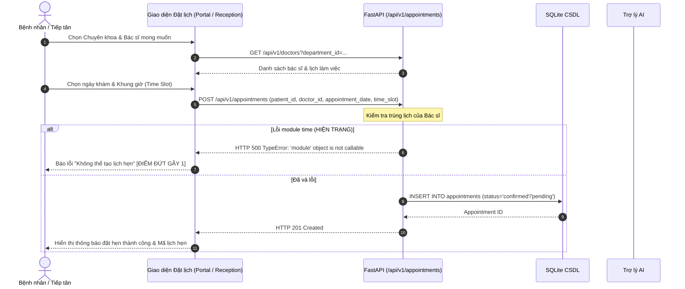
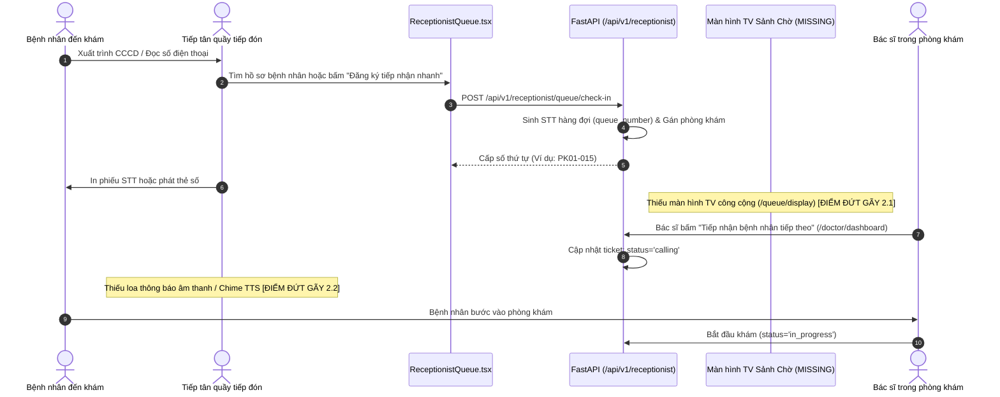
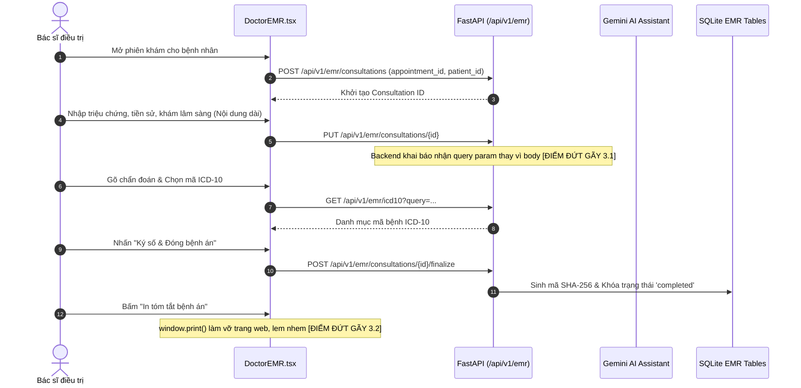
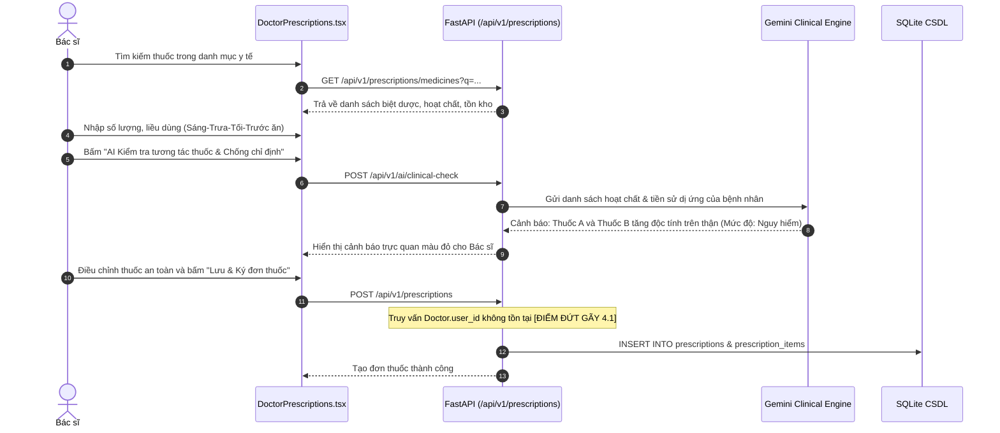
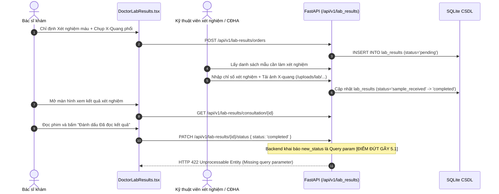
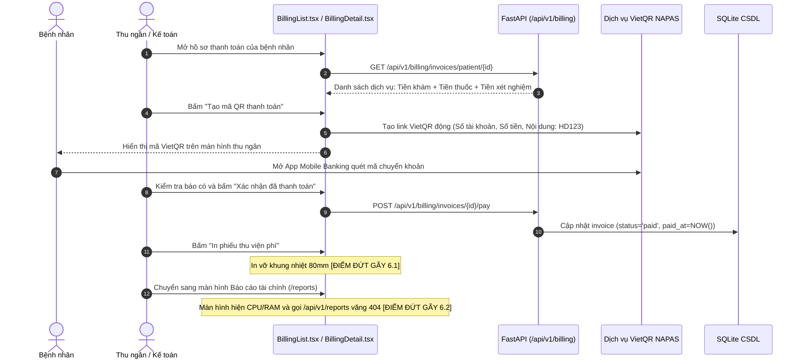
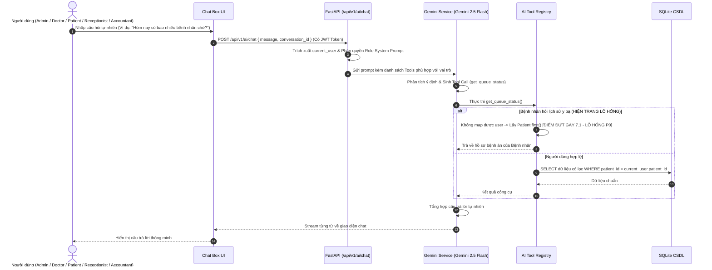

# BÁO CÁO KIỂM TOÁN QUY TRÌNH NGHIỆP VỤ Y TẾ TOÀN DIỆN
# (CLINICAL & ADMINISTRATIVE WORKFLOW AUDIT REPORT)
**Dự án**: AI Clinic Management System (Hệ Thống Quản Lý Phòng Khám Thông Minh)  
**Ngày kiểm toán**: 01/11/2026  
**Phạm vi**: 7 luồng quy trình nghiệp vụ cốt lõi từ tiếp đón, khám bệnh, cận lâm sàng, kê đơn, viện phí đến trợ lý AI  
**Trạng thái kiểm toán**: Hoàn tất – Đã vẽ sơ đồ luồng dữ liệu, xác định các điểm đứt gãy (Breakpoints) và đề xuất giải pháp liền mạch hóa.

---

## 1. TỔNG QUAN 7 QUY TRÌNH NGHIỆP VỤ CỐT LÕI

Hệ thống quản lý phòng khám thông minh vận hành dựa trên 7 chuỗi quy trình liên kết chặt chẽ giữa 5 tác nhân (Bệnh nhân, Tiếp tân, Bác sĩ, Dược sĩ/Kỹ thuật viên, Kế toán) và Hạ tầng Trợ lý AI:

1. **Quy trình 1: Đặt lịch hẹn khám bệnh (Appointment Booking Flow)** – Trực tuyến qua Cổng Bệnh nhân & Trực tiếp tại quầy Tiếp tân.
2. **Quy trình 2: Tiếp đón & Điều phối hàng đợi phòng khám (Check-in & Queue Flow)** – Lấy số thứ tự, phân luồng phòng khám, gọi số tự động.
3. **Quy trình 3: Khám bệnh & Ghi nhận bệnh án điện tử (Consultation & EMR Flow)** – Bác sĩ thăm khám, bắt mạch/đo sinh hiệu, nhập bệnh sử, gắn mã ICD-10 và ký số.
4. **Quy trình 4: Kê đơn thuốc & Cấp phát thuốc (Prescription & Pharmacy Flow)** – Chọn thuốc, AI kiểm tra tương tác thuốc, duyệt đơn và trừ tồn kho.
5. **Quy trình 5: Chỉ định & Trả kết quả Cận lâm sàng / Xét nghiệm (Lab Orders & Results Flow)** – Bác sĩ chỉ định, phòng xét nghiệm thực hiện, tải ảnh và bác sĩ đọc kết quả.
6. **Quy trình 6: Thu ngân, Lập hóa đơn & Thanh toán viện phí (Billing & Invoicing Flow)** – Tổng hợp chi phí khám/thuốc/xét nghiệm, giảm trừ BHYT, quét VietQR và in biên lai nhiệt.
7. **Quy trình 7: Tương tác Trợ lý AI đa vai trò & Gọi công cụ tự động (AI Multi-Role Agent Flow)** – Tiếp nhận câu hỏi tự nhiên, phân quyền dữ liệu, thực thi Tool Calling và phản hồi.

---

## 2. PHÂN TÍCH CHI TIẾT TỪNG QUY TRÌNH VÀ CÁC ĐIỂM ĐỨT GÃY (BREAKPOINTS)

### QUY TRÌNH 1: ĐẶT LỊCH HẸN KHÁM BỆNH (APPOINTMENT BOOKING)

#### 1.1. Sơ đồ quy trình (Workflow Sequence)


#### 1.2. Các tác nhân và thành phần tham gia
- **Tác nhân**: Bệnh nhân (tự đặt qua Portal) hoặc Tiếp tân (đặt hộ bệnh nhân qua điện thoại/tại quầy).
- **Màn hình liên quan**: `PatientAppointmentCreate.tsx`, `ReceptionistAppointmentCreate.tsx`.
- **API Endpoint**: `GET /api/v1/departments`, `GET /api/v1/doctors`, `POST /api/v1/appointments`.

#### 1.3. Điểm đứt gãy thực tế (Breakpoints Identified)
- **Breakpoint 1.1 [CRITICAL]**: Tại `backend/app/api/v1/receptionist.py` (dòng 4 và 137), lập trình viên vô tình viết `import time` đè lên lớp đối tượng `time` của module `datetime`. Khi backend gọi `time(hour=..., minute=...)` để parse khung giờ khám, Python quăng ngoại lệ `TypeError: 'module' object is not callable`, làm sụp đổ hoàn toàn endpoint tạo lịch hẹn ở cả phía Tiếp tân và Bệnh nhân.
- **Breakpoint 1.2**: Khi đặt lịch qua AI Chat bằng ngôn ngữ tự nhiên, tool `create_appointment` trong `services/ai_tool_registry.py:1675` truyền trực tiếp kwargs thay vì DTO schema `AppointmentCreate`, dẫn tới lỗi validation và AI không thể chốt lịch hẹn.

---

### QUY TRÌNH 2: TIẾP ĐÓN & ĐIỀU PHỐI HÀNG ĐỢI (CHECK-IN & QUEUE)

#### 2.1. Sơ đồ quy trình


#### 2.2. Điểm đứt gãy thực tế (Breakpoints Identified)
- **Breakpoint 2.1 [MISSING UI]**: Hệ thống hoàn toàn thiếu màn hình hiển thị hàng đợi công cộng dành riêng cho màn hình TV sảnh chờ (`/queue/display`). Bệnh nhân ngồi chờ không biết đang gọi đến số nào nếu không ra tận quầy tiếp tân hỏi.
- **Breakpoint 2.2 [MISSING AUDIO]**: Khi bấm nút "Gọi số", hệ thống không có âm thanh báo chuông (Chime ding-dong) và không có công nghệ Text-to-Speech (TTS) đọc tên bệnh nhân và phòng khám. Tiếp tân phải gọi loa cầm tay thủ công.
- **Breakpoint 2.3 [UNSYNC STATE]**: Khi bác sĩ bấm "Tiếp nhận ca tiếp theo" trên Doctor Dashboard, giao diện của Tiếp tân không tự động nhảy cập nhật ngay do thiếu kết nối WebSocket hai chiều.

---

### QUY TRÌNH 3: KHÁM BỆNH & GHI BỆNH ÁN ĐIỆN TỬ (CONSULTATION & EMR)

#### 3.1. Sơ đồ quy trình


#### 3.2. Điểm đứt gãy thực tế (Breakpoints Identified)
- **Breakpoint 3.1 [HTTP 414 CRASH]**: Tại `backend/app/api/v1/emr.py` (dòng 210-220), hàm cập nhật bệnh án `PUT /{consultation_id}` khai báo các trường ghi chú lâm sàng dưới dạng tham số URL Query (`notes: str = Query(...)`). Khi bác sĩ mô tả bệnh sử chi tiết (trên 1000 ký tự) kèm các dấu xuống dòng và ký tự đặc biệt, URL vượt quá giới hạn trình duyệt/webserver, gây lỗi **HTTP 414 URI Too Long** hoặc mất dữ liệu bệnh án.
- **Breakpoint 3.2 [PRINT TEMPLATE MISSING]**: Nút in tóm tắt bệnh án gọi `window.print()` trực tiếp. Vì thiếu CSS `@media print`, toàn bộ thanh menu bên trái (Sidebar), thanh tiêu đề (Header), các nút bấm màu sắc và thanh cuộn đều bị in ra giấy A4, tạo ra văn bản lem nhem không đạt chuẩn bệnh án y khoa.

---

### QUY TRÌNH 4: KÊ ĐƠN THUỐC & CẤP PHÁT THUỐC (PRESCRIPTION & PHARMACY)

#### 4.1. Sơ đồ quy trình


#### 4.2. Điểm đứt gãy thực tế (Breakpoints Identified)
- **Breakpoint 4.1 [ATTRIBUTE ERROR / DATA DRIFT]**: Trong `api/v1/prescriptions.py` (dòng 103), backend truy vấn `Doctor.user_id == current_user.id`. Tuy nhiên model `Doctor` chỉ có trường `staff_id` liên kết với bảng `staff` (rồi `staff.user_id` mới sang `users`). Lỗi này khiến backend bị lỗi `AttributeError` hoặc kích hoạt đoạn mã fallback nguy hiểm: tự động gán đơn thuốc cho bác sĩ đầu tiên tìm thấy trong CSDL (`doctor = db.query(Doctor).first()`). Kết quả là bác sĩ A kê đơn nhưng tên trên đơn thuốc lại thành Bác sĩ B!
- **Breakpoint 4.2 [NO STOCK DEDUCTION]**: Khi đơn thuốc được tạo hoặc khi bệnh nhân thanh toán tiền thuốc, hệ thống chưa có logic trừ số lượng tồn kho tự động trong bảng `medicines.stock_quantity`.

---

### QUY TRÌNH 5: CHỈ ĐỊNH & TRẢ KẾT QUẢ XÉT NGHIỆM / CẬN LÂM SÀNG (LAB ORDERS)

#### 5.1. Sơ đồ quy trình


#### 5.2. Điểm đứt gãy thực tế (Breakpoints Identified)
- **Breakpoint 5.1 [HTTP 422 MISMATCH]**: Tại `backend/app/api/v1/lab_results.py` (dòng 84-86), endpoint cập nhật trạng thái kết quả xét nghiệm định nghĩa:
  ```python
  @router.patch("/{result_id}/status")
  def update_lab_status(result_id: int, new_status: str, ...):
  ```
  FastAPI hiểu `new_status` là một URL Query Parameter (`?new_status=completed`). Trong khi đó, file `DoctorLabResults.tsx` lại gửi body JSON: `api.patch('/lab-results/' + id + '/status', { status: 'completed' })`. Mâu thuẫn này khiến mọi thao tác bấm "Đánh dấu Đã đọc" của Bác sĩ đều bị chặn đứng với mã lỗi **HTTP 422 Unprocessable Entity**.

---

### QUY TRÌNH 6: THU NGÂN, LẬP HÓA ĐƠN & THANH TOÁN VIỆN PHÍ (BILLING)

#### 6.1. Sơ đồ quy trình


#### 6.2. Điểm đứt gãy thực tế (Breakpoints Identified)
- **Breakpoint 6.1 [THERMAL RECEIPT PRINT MISSING]**: Các phòng khám sử dụng máy in hóa đơn nhiệt khổ 80mm (như Epson TM-T82, Xprinter). Nút in hóa đơn hiện tại chỉ kích hoạt in trang web A4 thông thường, làm tràn chữ và không thể in trên máy in nhiệt quầy thu ngân.
- **Breakpoint 6.2 [ACCOUNTANT REPORTS BROKEN]**: Phân hệ báo cáo tài chính của Kế toán bị lỗi hoàn toàn do:
  1. Frontend `Reports.tsx` hiển thị nhầm linh kiện DevOps (CPU, RAM, Server Load).
  2. Backend thiếu hoàn toàn tệp router `api/v1/reports.py`, khi tải trang gọi API bị trả về **HTTP 404 Not Found**.

---

### QUY TRÌNH 7: TƯƠNG TÁC TRỢ LÝ AI & TOOL CALLING ĐA TÁC NHÂN (AI CHAT)

#### 7.1. Sơ đồ quy trình


#### 7.2. Điểm đứt gãy thực tế (Breakpoints Identified)
- **Breakpoint 7.1 [SECURITY PRIVACY BREACH - P0]**: Trong `services/ai_tool_registry.py:1526`, đoạn mã fallback tự động lấy Bệnh nhân #1 khi không tìm thấy thông tin bệnh nhân làm rò rỉ toàn bộ lịch sử khám bệnh của người khác trong luồng chat.
- **Breakpoint 7.2 [ICD-10 SUMMARY CRASH]**: Khi tóm tắt lịch sử khám bệnh EMR (`ai_tool_registry.py:1940`), mã nguồn truy vấn nhầm trường `cd.diagnosis.code` thay vì `icd10_code`, gây lỗi Exception và AI ngưng phản hồi.

---

## 3. TỔNG HỢP MA TRẬN KHẮC PHỤC TÍNH LIỀN MẠCH CỦA 7 QUY TRÌNH

| Mã quy trình | Tên quy trình | Điểm đứt gãy chính | Mức độ ảnh hưởng | Giải pháp kỹ thuật đồng bộ |
|--------------|---------------|-------------------|------------------|---------------------------|
| **WF-01** | Đặt lịch khám | Lỗi `import time` ghi đè class time trong `receptionist.py` | Toàn bộ bệnh nhân và tiếp tân không đặt được lịch | Đổi thành `import time as _time` hoặc dùng `datetime.time` chuẩn |
| **WF-02** | Hàng đợi & Tiếp đón | Thiếu màn hình TV công cộng và Chime âm thanh | Bệnh nhân không theo dõi được STT phòng khám | Tạo trang `/queue/display` full-screen và tích hợp Web Audio API TTS |
| **WF-03** | Khám bệnh EMR | Ghi chú khám lâm sàng truyền qua Query Param | Gây lỗi HTTP 414 mất bệnh sử khi ghi chú dài | Chuyển sang nhận JSON Request Body `ConsultationUpdateDTO` |
| **WF-04** | Kê đơn thuốc | Truy vấn sai model `Doctor.user_id` và không trừ kho | Gán nhầm bác sĩ kê đơn và sai lệch tồn kho | Sửa query theo `Doctor.staff_id` và thêm trigger trừ kho `stock_quantity` |
| **WF-05** | Cận lâm sàng | Lệch kiểu dữ liệu PATCH `new_status` (Query vs Body) | Bác sĩ không thể duyệt hoàn tất kết quả xét nghiệm | Đồng bộ nhận JSON body `{ status: string }` tại `api/v1/lab_results.py` |
| **WF-06** | Thu ngân & Báo cáo | Báo cáo tài chính hiển thị CPU/RAM và thiếu API 404 | Kế toán không theo dõi được doanh thu và dòng tiền | Viết mới `api/v1/reports.py` và thiết kế lại `Reports.tsx` chuẩn kế toán |
| **WF-07** | Trợ lý AI Chat | Lỗ hổng fallback Patient #1 và sai thuộc tính ICD-10 | Rò rỉ thông tin y tế nhạy cảm và gãy tóm tắt EMR | Xóa bỏ đoạn fallback, cô lập session theo user_id và sửa tên thuộc tính |
